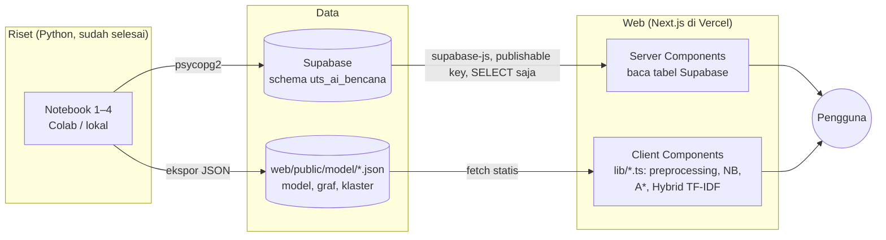

# Arsitektur Web

## 1. Gambaran besar



Dua sumber data, dengan pembagian tugas yang jelas:

| Sumber | Isi | Dipakai untuk | Alasan |
|---|---|---|---|
| `web/public/model/*.json` | Model Naive Bayes, aturan preprocessing, tabel stem, graf jalan, hasil klaster & ringkasan | Semua perhitungan di browser dan halaman Klaster | Harus tersedia walau Supabase mati; ikut di-deploy bersama web |
| Supabase (`uts_ai_bencana`) | Metrik model, prediksi, hasil benchmark searching, titik banjir, tempat aman, ringkasan | Tabel, grafik, dan angka di Beranda/Klasifikasi/Benchmark | Bukti bahwa hasil notebook tersimpan di database; mudah di-query |

Jika Supabase tidak terjangkau (misalnya project di-pause), halaman tetap tampil dengan data JSON dan menampilkan pemberitahuan kecil.

## 2. Stack

| Bagian | Pilihan | Catatan |
|---|---|---|
| Framework | **Next.js 16** (App Router) + React 19 + TypeScript | `create-next-app@latest` |
| Styling | **Tailwind CSS 4** + **daisyUI 5** | daisyUI untuk tema terang/gelap dan komponen dasar (navbar, card, table, tabs, badge, stat) |
| Animasi | **motion** (motion.dev) | Transisi halaman, angka berjalan, kemunculan kartu |
| Komponen animasi | **animate-ui** (opsional) | Berbasis shadcn. Ambil hanya komponen yang dibutuhkan; jangan memasang tema shadcn penuh agar tidak bentrok dengan daisyUI |
| Peta | **Leaflet 1.9** + **react-leaflet 5** | Tile OpenStreetMap (wajib mencantumkan atribusi). Muat sebagai client component tanpa SSR |
| Database | **@supabase/supabase-js 2** | Hanya `select` |
| Stemming kata baru | **sastrawijs** | Cadangan bila kata tidak ada di `stem_lookup.json` |
| Uji | **vitest** | Membandingkan `lib/*.ts` dengan `web/fixtures/*.json` |
| Hosting | **Vercel** (gratis) | Root directory proyek Vercel = `web` |

## 3. Struktur folder yang disarankan

```
web/
├── app/
│   ├── layout.tsx              # navbar, tema daisyUI, footer atribusi
│   ├── page.tsx                # F1 Beranda (Server Component)
│   ├── klaster/page.tsx        # F2 + F3 + F8
│   ├── rute/page.tsx           # F4 + F5 + F7
│   ├── klasifikasi/page.tsx    # F6
│   └── tentang/page.tsx        # F9
├── components/
│   ├── PetaRute.tsx            # 'use client' — Leaflet, di-import dengan next/dynamic { ssr: false }
│   ├── AnimasiPencarian.tsx    # memutar jejak node yang di-expand
│   ├── KartuKlaster.tsx
│   ├── SebaranKlaster.tsx      # scatter 2D (SVG biasa sudah cukup)
│   ├── KotakRingkas.tsx        # F3
│   ├── KotakKlasifikasi.tsx    # F6
│   └── ConfusionMatrix.tsx
├── lib/
│   ├── teks.ts                 # preprocessing
│   ├── naiveBayes.ts           # inferensi NB
│   ├── graf.ts                 # MinHeap, BFS, DFS, UCS, A*
│   ├── hybridTfidf.ts          # peringkasan
│   ├── data.ts                 # fetch + cache JSON model
│   └── supabase.ts             # createClient(URL, PUBLISHABLE_KEY, { db: { schema: 'uts_ai_bencana' } })
├── tests/                      # *.test.ts — vitest, membaca ../fixtures
├── fixtures/                   # JANGAN DIUBAH — dihasilkan scripts/buat_fixtures_web.py
└── public/model/               # JANGAN DIUBAH — dihasilkan notebook
```

## 4. Alur data per halaman

| Halaman | Server (Supabase) | Klien (JSON + lib) |
|---|---|---|
| Beranda | `model_metrics` (F1 terbaik), `search_runs` (rata-rata A* vs UCS), hitung `tweets` | `klaster_ringkasan.json` (k, jumlah klaster) |
| Klaster | `summaries` (opsional, untuk menunjukkan data tersimpan) | `klaster_ringkasan.json`; `preprocessing.json` + `stem_lookup.json` + `hybridTfidf.ts` untuk F3 |
| Rute | `search_runs` (F7 benchmark) | `graph_ciledug.json` + `graf.ts` untuk F4/F5 |
| Klasifikasi | `model_metrics`, contoh `predictions` join `tweets` | `naive_bayes.json` + `teks.ts` + `naiveBayes.ts` |

Server Components memakai `export const revalidate = 3600` (data jarang berubah) dan `try/catch` di sekitar query Supabase.

## 5. Keputusan desain

- **Model dijalankan di browser, bukan API Python.** Naive Bayes, A*, dan Hybrid TF-IDF ringan; port ke TypeScript menghindari server
  Python berbayar dan membuat demo tetap jalan meski koneksi lambat. Konsistensi dijaga oleh fixtures.
- **Satu sumber kebenaran per angka.** Angka di Beranda dihitung dari data, bukan diketik.
- **Graf dimuat lazy.** Hanya halaman Rute yang mengunduh `graph_ciledug.json`.
- **Animasi dari jejak nyata.** Fungsi pencarian mengembalikan urutan node yang di-expand (`jejak`); komponen animasi hanya memutar ulang
  array itu. Tidak ada animasi palsu.
